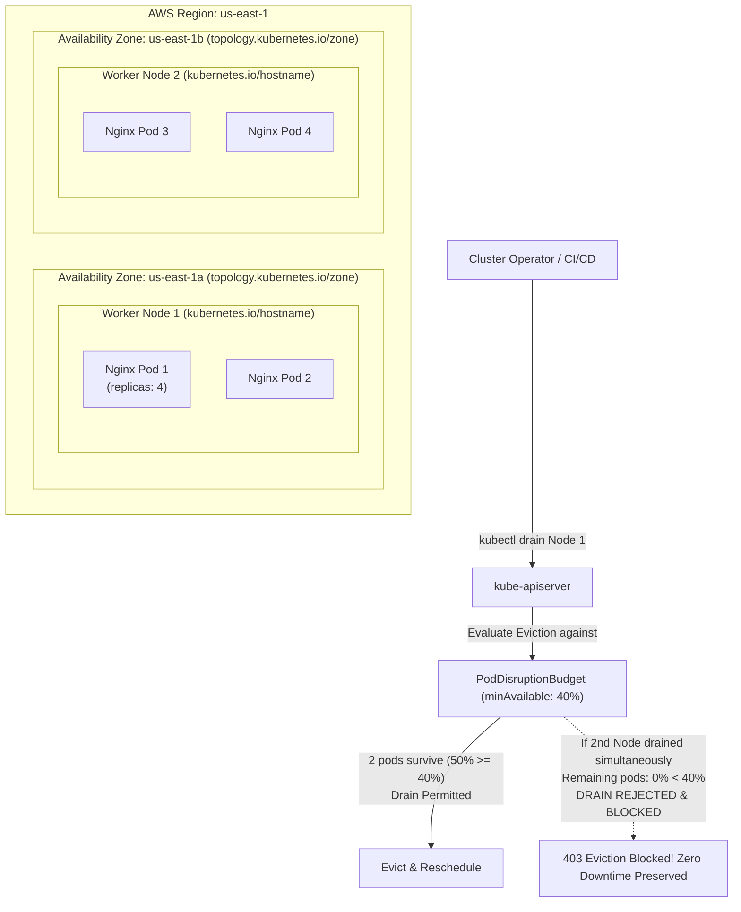
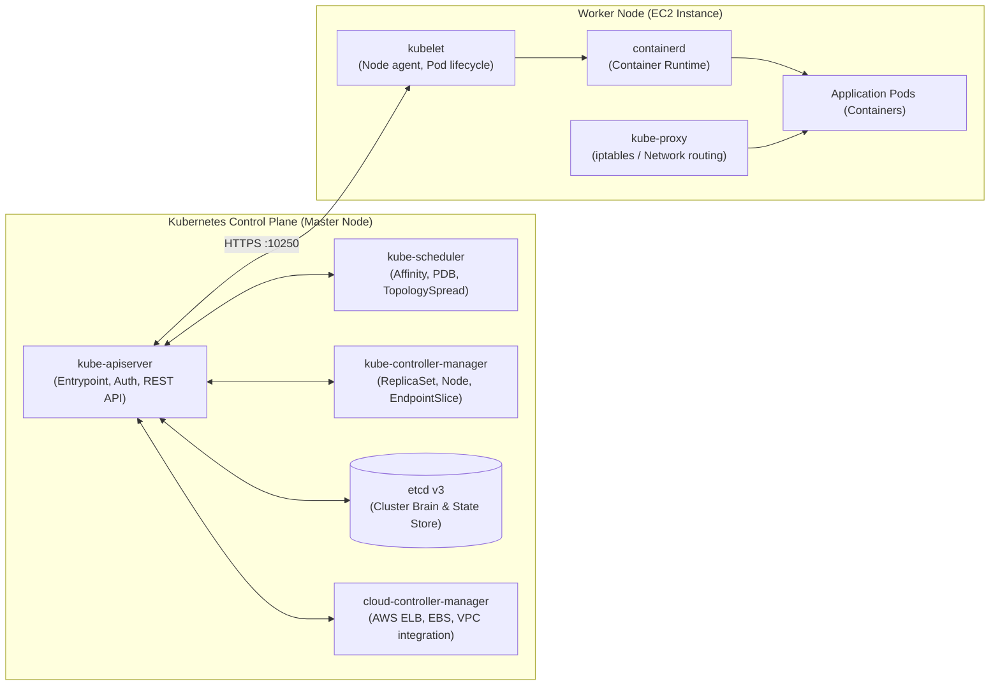
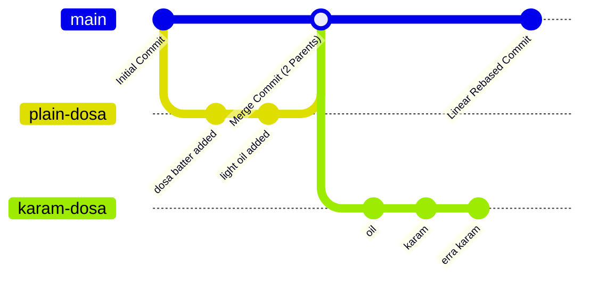

# Kubernetes High Availability & Zero-Downtime Governance (`k8-ha`)

This repository demonstrates the end-to-end implementation of **Kubernetes High Availability (HA)** using **Pod Disruption Budgets (PDB)** and **TopologySpreadConstraints**. It guarantees that mission-critical microservices remain 100% available during voluntary disruptions (node maintenance, cluster platform upgrades, scaling events) while preventing single points of failure across AWS Availability Zones and worker nodes.

> 📊 **Visual Diagrams & Interactive Simulator**:
> - 🌐 **Archify Native Architecture Diagram**: [`k8-ha-architecture.html`](file:///Users/sriramcharankolla/Desktop/DevOps/k8-ha/k8-ha-architecture.html) (Full animated nodes, AWS AZ boundaries, blueprint view).
> - ⚡ **PDB & Topology Live Simulator**: [`k8-ha-simulator.html`](file:///Users/sriramcharankolla/Desktop/DevOps/k8-ha/k8-ha-simulator.html) (Interactive browser app to simulate node drains, eviction blocking, and live PDB math).

---

## 🏗️ High Availability Architecture & Distribution Flow



---

## 🔑 Core Concept 1: Pod Disruption Budget (PDB)

A **Pod Disruption Budget (`policy/v1`)** limits the number of replicated pods that can be concurrently down due to **voluntary disruptions**.

### 1. Voluntary vs. Involuntary Disruptions

| Disruption Type | Definition & Causes | Can PDB Protect It? |
| :--- | :--- | :--- |
| **Voluntary Disruptions** | Administrative operations initiated by engineers, CI/CD, or cluster controllers (e.g., `kubectl drain`, node replacement during EKS Blue/Green platform upgrades, node termination during cluster autoscaler scale-down, kernel patching). | **YES (100%)**. The Kubernetes Eviction API strictly checks PDB before allowing any pod eviction. |
| **Involuntary Disruptions** | Unplanned failures outside human or Kubernetes control (e.g., physical hardware failure in AWS datacenter, power outage, hypervisor panic, VM crash, kernel panic). | **NO**. PDB cannot stop physical hardware from failing, but `kubelet` and `kube-scheduler` automatically recreate missing pods on surviving nodes. |

### 2. `minAvailable` vs. `maxUnavailable`

* **`minAvailable`** (Recommended): Defines the minimum number or percentage of pods that must stay in `Ready` state after any eviction (e.g., `minAvailable: "40%"` or `minAvailable: 2`).
* **`maxUnavailable`**: Defines the maximum number or percentage of pods that can be unavailable during eviction (e.g., `maxUnavailable: 1` or `maxUnavailable: "25%"`).

### 3. The PDB Mathematical Calculation Formula

To ensure that at least one worker node can be drained safely without violating the disruption budget, the target minimum availability is calculated as:

$$\text{minAvailable} = \frac{\text{Total Pods} - \text{Maximum Pods on a Single Node}}{\text{Total Pods}}$$

#### Real-World Calculation Scenarios:

#### Scenario A: 3 Nodes, 5 Pods (`2 : 2 : 1` Distribution)
* Max pods on any single node = `2`.
* Remaining pods when Node-1 is drained = $5 - 2 = 3$ pods.
* Availability ratio = $\frac{3}{5} = 60\%$.
* **Result**: Setting `minAvailable: "60%"` allows draining Node-1 (60% remaining), Node-2 (60% remaining), or Node-3 (80% remaining). All single-node drains **succeed**!

#### Scenario B: 2 Nodes, 4 Pods (`2 : 2` Distribution - Our Manifest)
* Max pods on any single node = `2`.
* Remaining pods when Node-1 is drained = $4 - 2 = 2$ pods.
* Availability ratio = $\frac{2}{4} = 50\%$.
* **Result**: In [`manifest.yaml:L59`](file:///Users/sriramcharankolla/Desktop/DevOps/k8-ha/manifest.yaml#L59), we set `minAvailable: "40%"`.
  * Draining Node-1 leaves 2 pods ($50\% \ge 40\%$) $\rightarrow$ **Drain Succeeds**!
  * Attempting to drain Node-2 simultaneously would leave 0 pods ($0\% < 40\%$) $\rightarrow$ **Drain is strictly BLOCKED by PDB**!

#### Scenario C: 2 Nodes, 7 Pods (`4 : 3` Distribution)
* Max pods on any single node = `4`.
* Remaining pods when Node-1 is drained = $7 - 4 = 3$ pods.
* Availability ratio = $\frac{3}{7} \approx 42.8\%$.
* **Result**: If an engineer sets `minAvailable: "50%"` or `"60%"`, draining Node-1 will **FAIL** because 42.8% is less than the required threshold!

---

## 🌐 Core Concept 2: TopologySpreadConstraints

While PDB controls *how many* pods can be evicted at once, **`topologySpreadConstraints`** controls *where* pods are placed when scheduled, preventing pod clustering.

### Two-Tier Spread Hierarchy:

1. **Multi-AZ Availability (`topologyKey: topology.kubernetes.io/zone`)**:
   * Ensures pods are evenly divided across AWS Availability Zones (e.g., `us-east-1a` and `us-east-1b`).
   * If an entire AWS data center encounters an outage, 50% of the microservice replicas remain active in the surviving AZ.
2. **Multi-Node Availability (`topologyKey: kubernetes.io/hostname`)**:
   * Ensures pods are evenly balanced across individual EC2 worker nodes within each zone.

### Key Configuration Directives:

* **`maxSkew: 1`**: The maximum allowed difference in pod count between any two topology domains. A value of `1` enforces near-perfect parity.
* **`whenUnsatisfiable: DoNotSchedule` (Hard Rule)**:
  * If scheduling a pod would violate `maxSkew: 1`, the pod remains in `Pending` state rather than clustering on a single node.
  * Contrast with `whenUnsatisfiable: ScheduleAnyway` (Soft Rule), which schedules the pod as a fallback.
* **`labelSelector`**: Explicitly matches target pods using `project: roboshop`, `purpose: rs-demo`, `tier: frontend`, `component: frontend`.

> [!WARNING]
> **EKS Topology Key Deprecation**: In legacy Kubernetes versions, the zone label was `failure-domain.beta.kubernetes.io/zone`. In modern EKS (v1.28 to v1.35), using the legacy key causes pods to remain permanently `Pending`. Always use the standard GA key **`topology.kubernetes.io/zone`**.

---

## 📄 Manifest Deep Dive: [`manifest.yaml`](file:///Users/sriramcharankolla/Desktop/DevOps/k8-ha/manifest.yaml)

```yaml
apiVersion: apps/v1
kind: Deployment
metadata:
  name: nginx
  labels:
    project: roboshop
    purpose: rs-demo
    tier: frontend
    component: frontend
  annotations:
    kubernetes.io/change-cause: "moving to 1.29.7"
spec:
  replicas: 4
  selector:
    matchLabels:
      project: roboshop
      purpose: rs-demo
      tier: frontend
      component: frontend
  template:
    metadata:
      labels:
        project: roboshop
        purpose: rs-demo
        tier: frontend
        component: frontend
    spec:
      topologySpreadConstraints:
      # Tier 1: Multi-AZ Spread
      - maxSkew: 1
        topologyKey: topology.kubernetes.io/zone
        whenUnsatisfiable: DoNotSchedule
        labelSelector: 
          matchLabels:
            project: roboshop
            purpose: rs-demo
            tier: frontend
            component: frontend
      # Tier 2: Multi-Host Spread
      - maxSkew: 1
        topologyKey: kubernetes.io/hostname
        whenUnsatisfiable: DoNotSchedule
        labelSelector:
          matchLabels:
            project: roboshop
            purpose: rs-demo
            tier: frontend
            component: frontend
      containers:
      - name: nginx
        image: nginx:1.29.7
---
apiVersion: policy/v1
kind: PodDisruptionBudget
metadata:
  name: nginx
spec:
  minAvailable: "40%"
  selector:
    matchLabels:
      project: roboshop
      purpose: rs-demo
      tier: frontend
      component: frontend
```

### Line-by-Line Breakdown:

* **[Lines 14-21](file:///Users/sriramcharankolla/Desktop/DevOps/k8-ha/manifest.yaml#L14-L21)**: Sets `replicas: 4` and configures the ReplicaSet selector labels.
* **[Lines 31-40](file:///Users/sriramcharankolla/Desktop/DevOps/k8-ha/manifest.yaml#L31-L40)**: Defines the primary Zone-level topology constraint (`topology.kubernetes.io/zone`), guaranteeing 2 pods in `us-east-1a` and 2 pods in `us-east-1b`.
* **[Lines 41-49](file:///Users/sriramcharankolla/Desktop/DevOps/k8-ha/manifest.yaml#L41-L49)**: Defines the secondary Host-level topology constraint (`kubernetes.io/hostname`), ensuring individual nodes within an AZ don't hold all replicas.
* **[Lines 50-52](file:///Users/sriramcharankolla/Desktop/DevOps/k8-ha/manifest.yaml#L50-L52)**: Runs the application container `nginx:1.29.7`.
* **[Lines 54-66](file:///Users/sriramcharankolla/Desktop/DevOps/k8-ha/manifest.yaml#L54-L66)**: Deploys `PodDisruptionBudget/nginx` with `minAvailable: "40%"`, binding directly to the frontend pod labels.

---

## 🛠️ Step-by-Step Hands-On Verification Runbook

### Step 1: Deploy Manifest
```bash
kubectl apply -f manifest.yaml
```

### Step 2: Verify Balanced Scheduling Across Zones & Nodes
```bash
kubectl get pods -o wide --show-labels
```
*Expected Output*:
* 2 pods scheduled on Node 1 (`ip-10-0-11-173.ec2.internal` in zone `us-east-1a`).
* 2 pods scheduled on Node 2 (`ip-10-0-12-52.ec2.internal` in zone `us-east-1b`).

### Step 3: Inspect PodDisruptionBudget Status
```bash
kubectl get pdb
```
*Expected Output*:
```text
NAME    MIN AVAILABLE   MAX UNAVAILABLE   ALLOWED DISRUPTIONS   AGE
nginx   40%             N/A               2                     5m
```
> Notice: `ALLOWED DISRUPTIONS: 2`. Since 4 pods exist and `minAvailable: 40%` requires at least 2 pods running, the cluster permits up to 2 simultaneous evictions.

### Step 4: Simulate Node Maintenance (Cordon & Drain)
```bash
# Drain Node 1:
kubectl drain <NODE_NAME> --ignore-daemonsets --delete-emptydir-data
```
1. `kubectl cordon` disables new pod scheduling on this node.
2. Eviction API checks PDB: 2 pods evicted from Node 1, 2 pods remain running on Node 2 ($50\% \ge 40\%$).
3. Drain completes successfully.

### Step 5: Restore Worker Node
```bash
kubectl uncordon <NODE_NAME>
```
Scheduling is re-enabled on the node.

---

## 🏛️ Kubernetes End-to-End Architecture (Session 71 Deep Dive)



### 1. Control Plane Components

* **`kube-apiserver`**: The front-door REST interface. All requests (`kubectl`, UI, workers) authenticate and authorize through API server. It is stateless and stores data exclusively in `etcd`.
* **`kube-scheduler`**: Assigns unscheduled (`Pending`) pods to optimal nodes. It factors in resource requests (CPU/RAM), node affinity/anti-affinity, taints and tolerations, and **TopologySpreadConstraints**.
* **`kube-controller-manager`**: Continuous control loops reconciling actual state toward desired state:
  * *ReplicaSet Controller*: Ensures desired pod counts match specifications.
  * *Node Controller*: Detects and handles node failures.
  * *EndpointSlice Controller*: Updates IP lists for Service endpoints.
  * *ServiceAccount Controller*: Manages default service accounts for new namespaces.
* **`etcd`**: Distributed, strongly consistent key-value store holding the complete state, configs, secrets, and metadata of the cluster.
* **`cloud-controller-manager`**: Bridges Kubernetes primitives with cloud-provider APIs (AWS ELB provisioning, node IP discovery, route table updates).

### 2. Worker Node Components

* **`kubelet`**: The primary agent running on each worker node. It registers the node with `apiserver`, monitors PodSpecs, mounts volumes, and ensures containers are running and healthy.
* **`kube-proxy`**: Manages networking and packet forwarding via `iptables` or `IPVS`, routing traffic sent to Service ClusterIPs directly to the appropriate pod endpoints.
* **Container Runtime (`containerd`)**: Executes and manages the container lifecycle according to the Container Runtime Interface (CRI).

---

## 🐙 Enterprise Git Collaboration & Release Workflow

Session 71 introduced enterprise Git practices to prevent accidental production branch overwrites through **GitHub Rulesets** and structured PR workflows.

### 1. Branching Strategy & GitHub Rulesets

To enforce code quality and protect the `main` branch:
1. Navigate to GitHub Repository $\rightarrow$ **Settings** $\rightarrow$ **Rules** $\rightarrow$ **Rulesets** $\rightarrow$ **New ruleset**.
2. Target: `Include default branch (main)`.
3. Enforcement:
   * **Restrict deletions**: Prevents deleting the `main` branch.
   * **Block force pushes (`git push --force`)**: Prevents rewriting upstream shared history.
   * **Require a pull request before merging**: Developers cannot push directly to `main`.
   * **Require approvals**: At least `1` code review approval before merging is unblocked.

### 2. Merge Commit vs. Rebase: The "Dosa-Shop" Case Study



#### Comparison:

| Feature | Merge Commit (`git merge`) | Rebase (`git rebase`) |
| :--- | :--- | :--- |
| **History Structure** | Non-linear with branching bubbles and explicit merge commits. | Linear, flat single-line history. |
| **Commit Integrity** | **Preserves exact history**: Keeps the original commit timestamps and IDs untouched. | **Rewrites commits**: Creates brand new commit hashes on top of the base branch. |
| **Parent Count** | Special merge commit has **2 parents**. | Regular commit with **1 parent**. |
| **When to Use** | Standard feature releases where keeping the complete team PR context is desired. | Cleaning up local commits before PR review or maintaining a pristine linear history. |

---

## ⚠️ Common Gotchas & Troubleshooting Matrix

| Symptom / Error | Root Cause | Solution |
| :--- | :--- | :--- |
| `0/2 nodes are available: 2 node(s) didn't match pod topology spread constraints` | Deprecated key `failure-domain.beta.kubernetes.io/zone` was used in `manifest.yaml`. | Update key to GA label: `topology.kubernetes.io/zone` and re-apply. |
| `Cannot evict pod as it would violate the pod's disruption budget` | `kubectl drain` attempted while remaining pods would drop below `minAvailable` percentage. | Wait for rescheduled pods to report `Ready` on target nodes, or adjust PDB percentage to allow maintenance. |
| `Push rejected: Protected branch hook declined` | Direct push attempted against GitHub `main` branch with active Ruleset. | Create a feature branch (`git checkout -b <branch>`), push to origin, and open a Pull Request. |
